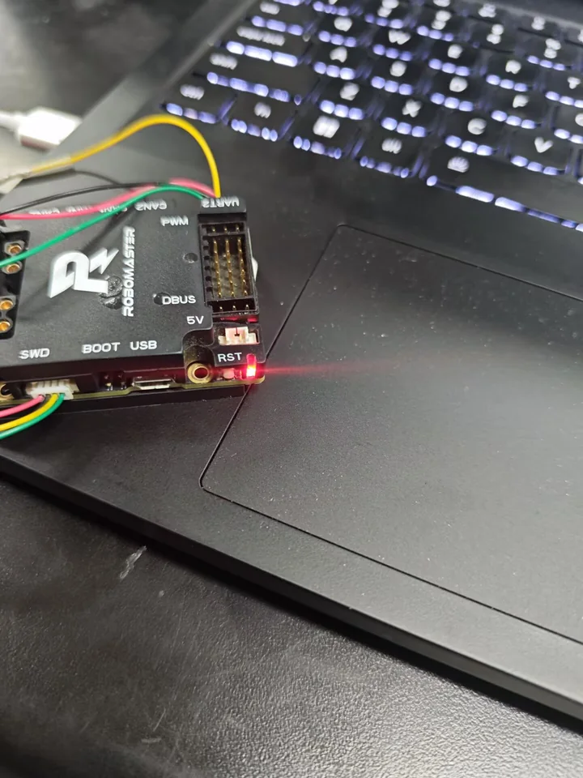
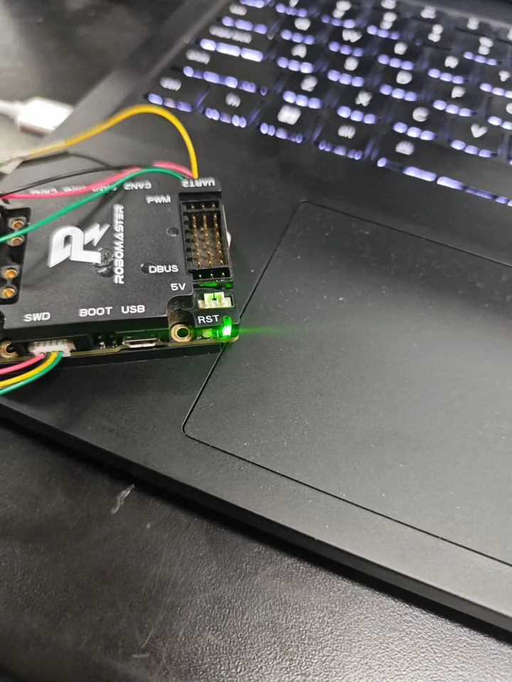
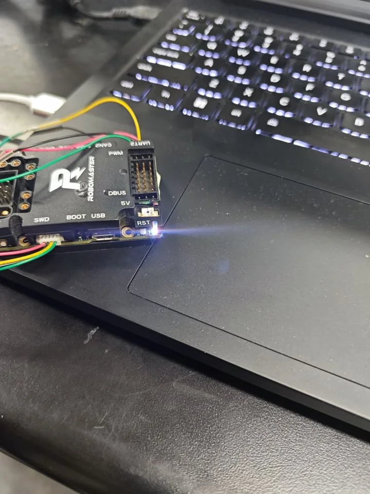

# UART RGB 呼吸灯

通过 UART 将 RGB 颜色从电脑发送到 STM32 开发板，并驱动一颗 RGB 灯显示呼吸效果。项目同时提供无需编译的 PowerShell 发送端、跨平台 C++ 发送端和 STM32 HAL 接收端参考代码。



| 绿色 | 蓝色 |
|---|---|
|  |  |

照片为实际联调结果。发送端计算亮度，灯色由电控端接收到的 RGB 数值和 LED 驱动方式决定。

## 功能

- 以 50 Hz 发送经过 CRC-16/CCITT-FALSE 校验的 6 字节 RGB 数据帧。
- 支持呼吸灯、固定颜色、红绿蓝白轮播和离线自测。
- PowerShell 版本无需安装 Python，也不需要编译。
- C++17 版本支持 Windows 和 Linux 串口。
- 提供 STM32 HAL 接收、CRC 校验、PWM 输出和超时关灯参考实现。
- 附带 GitHub Actions，在 Windows 上检查脚本并编译 C++ 发送端。

## 快速开始

### 1. 准备硬件

需要电脑 USB 串口、USB 转 3.3 V TTL 模块或开发板自带串口，以及完成接收端程序的 STM32 和 RGB 灯。

最低接线：

```text
视觉端 TX  ->  电控端 RX
视觉端 GND --- 电控端 GND
```

如果还需要反方向通信，再接：

```text
视觉端 RX  <-  电控端 TX
```

不要将 RS-232 的 ±12 V 信号直接接到 STM32。

### 2. 确认串口

在项目根目录打开 PowerShell：

```powershell
.\send_breath.ps1 -ListPorts
```

如果系统禁止运行本地脚本：

```powershell
powershell -ExecutionPolicy Bypass -File .\send_breath.ps1 -ListPorts
```

从结果中找到 USB 串口，例如 `COM5` 或 `COM7`。后文示例中的 `COM5` 必须替换为实际值。

### 3. 先离线验证

不连接硬件也能检查帧生成：

```powershell
.\send_breath.ps1 -DryRun -Seconds 6
```

终端中的完整帧应包含 `A5` 帧头、RGB 数值和两个 CRC 字节。

### 4. 固定颜色测试

确认接线和电控程序后，先固定显示红色：

```powershell
.\send_breath.ps1 -Port COM5 -Color "255,0,0" -Hold
```

依次尝试绿色和蓝色，确认颜色通道没有接反：

```powershell
.\send_breath.ps1 -Port COM5 -Color "0,255,0" -Hold
.\send_breath.ps1 -Port COM5 -Color "0,0,255" -Hold
```

### 5. 运行呼吸灯

```powershell
.\send_breath.ps1 -Port COM5 -Color "0,160,255"
```

默认呼吸周期为 2 秒。按 `Ctrl+C` 停止，程序退出时会发送熄灭帧。

Windows 下还可以双击 `运行20秒.cmd`。它会自动寻找 CH340、CP210x、FTDI 或 USB-SERIAL 设备，以青蓝色呼吸 20 秒，然后自动关灯。若电脑上同时存在多个 USB 串口，请用 `-Port` 明确指定。

## 通信协议

固定参数为 `115200 8N1`、无流控、3.3 V TTL。每帧 6 字节：

| 偏移 | 字段 | 说明 |
|---|---|---|
| 0 | `header` | 固定 `0xA5` |
| 1 | `R` | 红色，`0~255` |
| 2 | `G` | 绿色，`0~255` |
| 3 | `B` | 蓝色，`0~255` |
| 4 | `CRC low` | CRC 低字节 |
| 5 | `CRC high` | CRC 高字节 |

CRC 参数：

| 项目 | 值 |
|---|---|
| 算法 | CRC-16/CCITT-FALSE |
| 多项式 | `0x1021` |
| 初始值 | `0xFFFF` |
| 输入/输出反转 | 否 |
| 结果异或 | `0x0000` |

校验基准：ASCII `123456789` 的 CRC 应为 `0x29B1`。

常用测试帧：

| 颜色 | RGB | 数据帧 |
|---|---|---|
| 关闭 | `0,0,0` | `A5 00 00 00 F3 D2` |
| 红 | `255,0,0` | `A5 FF 00 00 90 1D` |
| 绿 | `0,255,0` | `A5 00 FF 00 0C D1` |
| 蓝 | `0,0,255` | `A5 00 00 FF 03 CC` |
| 白 | `255,255,255` | `A5 FF FF FF 9F 00` |
| 青蓝 | `0,160,255` | `A5 00 A0 FF 7D D1` |

完整协议见 [protocol.md](protocol.md)。

## C++ 版本

需要 CMake 3.16+、C++17 编译器，以及 Windows 上的 Visual Studio Build Tools 或 Linux 上的 GCC/Clang。

```powershell
cmake -S . -B build
cmake --build build --config Release
```

Windows 默认构建产物：

```powershell
.\build\Release\breath_sender.exe --list-ports
.\build\Release\breath_sender.exe --dry-run --seconds 6
.\build\Release\breath_sender.exe --port COM5 --color 255,0,0 --hold
.\build\Release\breath_sender.exe --port COM5 --color 0,160,255 --freq 0.5 --fps 50
```

使用单配置生成器时，可执行文件也可能位于 `build\breath_sender.exe`。

## STM32 接收端

`ecu/` 提供可直接加入 STM32 HAL 工程的参考代码：

- `breath_receiver.c`：逐字节收包、CRC 校验、PWM 更新和 200 ms 超时关灯。
- `breath_receiver.h`：接收端接口。
- `INTEGRATION.md`：CubeMX 配置、函数调用和 WS2812 修改说明。

参考代码默认使用 `huart1` 和 `htim2` 的三个 PWM 通道，这些只是示例。必须根据实际开发板原理图和电控工程修改串口、定时器、通道、PWM 极性及最大比较值。

## 目录结构

```text
.
├── README.md
├── LICENSE
├── protocol.md
├── send_breath.ps1
├── run_20s.ps1
├── 运行20秒.cmd
├── src/
│   └── main.cpp
├── ecu/
│   ├── breath_receiver.c
│   ├── breath_receiver.h
│   └── INTEGRATION.md
├── docs/
│   └── images/
└── .github/
    └── workflows/
        └── ci.yml
```

## 实现说明

发送端根据余弦曲线计算亮度：

```text
brightness = (1 - cos(2πft)) / 2
R = baseR × brightness
G = baseG × brightness
B = baseB × brightness
```

随后生成 `A5 R G B CRC_L CRC_H` 数据帧，并以 50 Hz 写入串口。接收端只在帧头和 CRC 都有效时才更新 PWM；超过 200 ms 没有收到有效帧时自动关灯。

## 常见问题

| 现象 | 检查内容 |
|---|---|
| 找不到串口 | USB 线是否支持数据、驱动是否安装、是否插在充电口 |
| 打不开串口 | 串口号是否正确，是否被串口助手或其他程序占用 |
| 灯完全没反应 | TX/RX 是否交叉、是否共地、波特率是否为 115200 |
| 所有帧都被丢弃 | CRC 参数、帧头、字节顺序是否一致 |
| 红绿蓝接反 | PWM 通道接线、共阳/共阴极性或 WS2812 的 GRB 顺序 |
| 只亮不呼吸 | 电控是否每帧更新 PWM，是否又缓存或叠加了渐变 |
| 灯一直保持最后颜色 | 是否在主循环调用 `BreathReceiver_Tick()` |

## 验证

本地已验证：

- PowerShell 发送端离线运行 1 秒，共生成 50 帧。
- C++ 发送端离线运行 1 秒，共生成 50 帧。
- 实际串口分别验证红色、绿色和蓝色显示。
- 20 秒脚本可通过 CH340 串口发送，并在结束后发送熄灭帧。

显示结果以实际硬件、LED 驱动方式和电控端映射为准；颜色顺序或亮度不同不一定代表串口协议错误。

## License

本项目使用 [MIT License](LICENSE)。

## 说明

本项目为西农猎隼算法组作业，部分代码与文档使用 AI 工具辅助完成，硬件连接和实际效果已通过现场联调验证。
